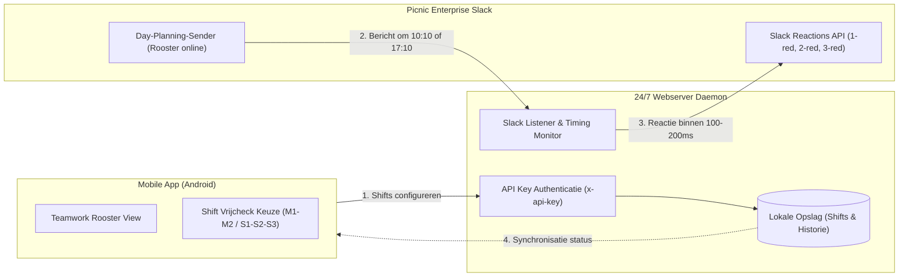

# AutoChecker - Picnic Vrijcheck App & 24/7 Cloud Daemon

[](https://github.com/jayverrijt/AutoChecker/actions/workflows/android-release.yml)
[](https://github.com/jayverrijt/AutoChecker/actions/workflows/server-ci-cd.yml)
[](https://nodejs.org)
[](https://capacitorjs.com)
[](LICENSE)

Migratie-notitie: De voormalige browser-extensie (`manifest.json` / `content.js`) is deprecated en vervangen door deze full-stack oplossing: een native Android-applicatie gekoppeld aan een standalone 24/7 server daemon.

---

## Systeemarchitectuur

Het systeem bestaat uit twee componenten: een 24/7 server daemon en een Android client applicatie.



1. **24/7 Webserver Daemon (Node.js)**:
   - Draait op een server, VPS, Raspberry Pi of Docker container.
   - Beveiligd via een token (`SERVER_API_KEY` / `x-api-key`).
   - Monitort het Slack-kanaal tijdens de specifieke publicatiemomenten (10:10 en 17:10) met een versnelde polling-interval.
   - Plaatst direct de bijbehorende emoji-reactie via de Slack Enterprise API zodra een roosterbericht van `Day-Planning-Sender` wordt gedetecteerd.

2. **Android Client (Capacitor & React)**:
   - Gebruikersinterface gemodelleerd naar Picnic Teamwork.
   - Weekoverzicht met dagweergave en ondersteuning voor de 5 individuele shiftblokken per dag.
   - Mogelijkheid om per blok vrijcheck in- of uit te schakelen.
   - Communicatie met de server daemon via REST endpoints.

---

## Shifttijden & Emoji Matching

De onderstaande shiftindeling en standaardtijden zijn direct afgestemd op de blokken in Picnic Teamwork:

| Periode | Shift Blok | Shifttijden | Berichttijd Planning | Standaard Emoji |
|---|---|---|---|---|
| Ochtend | M1 | 06:30 - 09:15 | 17:10 (dag van tevoren) | 1-red |
| Ochtend | M2 | 09:15 - 12:00 | 17:10 (dag van tevoren) | 2-red |
| Middag | S1 | 14:00 - 16:45 | 10:10 (dezelfde dag) | 1-red |
| Middag | S2 | 16:45 - 19:30 | 10:10 (dezelfde dag) | 2-red |
| Middag | S3 | 19:30 - 22:15 | 10:10 (dezelfde dag) | 3-red |

---

## Installatie & Configuratie

### 1. Webserver Daemon

#### Vereisten
- Node.js 20 of nieuwer
- npm

#### Installatiestappen
```bash
cd server
cp .env.example .env
npm install
```

Configureer in `.env` minimaal:
```env
PORT=3001
SERVER_API_KEY=kies_hier_een_veilig_wachtwoord
SLACK_WORKSPACE_URL=https://picnic.enterprise.slack.com
SLACK_CHANNEL_ID=C0xxxxxxxxx
```

#### Starten met PM2 (Productie)
```bash
npm install -g pm2
pm2 start ecosystem.config.cjs
pm2 save
pm2 startup
```

#### Starten met Docker
```bash
docker compose up -d --build
```

---

### 2. Mobiele App (Android APK)

#### Vereisten
- Node.js 22 of nieuwer
- JDK 21
- Android SDK & Build-tools (API 34/35)

#### Build-instructies
```bash
cd client
npm install
npm run build
npx cap sync android

# Debug APK bouwen
cd android
./gradlew assembleDebug
```

De resulterende APK bevindt zich in:
`client/android/app/build/outputs/apk/debug/app-debug.apk`

---

## Gebruik & Authenticatie

### 1. Slack Authenticatiegegevens Ophalen
Omdat Picnic Slack Enterprise Grid gebruikt, authenticieert de bot via uw sessietoken:

1. Open [picnic.enterprise.slack.com](https://picnic.enterprise.slack.com) in de browser en log in.
2. Open de ontwikkelaarstools (F12 of Cmd+Option+I) en navigeer naar het tabblad **Network**.
3. Selecteer een willekeurig API-verzoek (bijvoorbeeld `conversations.history` of `client.boot`).
4. Kopieer uit de request headers:
   - **Authorization**: Bearer token (begint met `xoxc-...`)
   - **Cookie**: Waarde van cookie `d` (begint met `xoxd-...`)
5. Open in de AutoChecker app het menu **Instellingen** en sla deze gegevens op.

### 2. Verbinding met de Webserver Configureren
1. Voer in de app bij Instellingen het adres van de webserver in (bijvoorbeeld `https://vps.jouwdomein.nl` of `http://192.168.1.50:3001`).
2. Vul de ingestelde `SERVER_API_KEY` in.
3. Test de verbinding via de testknop.

### 3. Vrijcheck Activeren
1. Navigeer naar het tabblad **Rooster**.
2. Selecteer de dag en het betreffende shiftblok (M1, M2, S1, S2 of S3).
3. Activeer de schakelaar of gebruik de bevestigingsslider om vrijcheck in te schakelen.
4. De server monitort automatisch het kanaal op het publicatiemoment en plaatst de reactie zodra het rooster online komt.

---

## Testsuite & Emulatie

De server bevat een testsuite inclusief emulator voor `Day-Planning-Sender`:

```bash
cd server
npm test
```

De testsuite valideert:
- Authenticatie en beveiliging van alle endpoints via `x-api-key`.
- Correcte herkenning van ochtend- en middagberichten.
- Selectie van de juiste emoji op basis van het ingestelde shiftblok.
- Reactietijden onder willekeurige netwerkjitter (gemiddeld ~100ms verwerkingstijd).
- Afhandeling van uitgeschakelde shifts en datum-mismatches.

---

## CI/CD Pipelines

De GitHub Actions workflows zijn geconfigureerd in `.github/workflows/`:

- `android-release.yml`:
  Bouwt de Android debug APK automatisch bij pushes naar `main` en genereert een GitHub Release met de APK als download bij git tags (`v*`).

- `server-ci-cd.yml`:
  Draait de Node.js testsuite en verzorgt automatische deployment via SSH naar een server met behulp van de geconfigureerde repository secrets:
  - `FLEETHUB_SSH_KEY` / `SSH_PRIVATE_KEY`
  - `FLEETHUB_HOST` / `SERVER_HOST`
  - `FLEETHUB_USER` / `SERVER_USER`
  - `FLEETHUB_DEPLOY_PATH` / `SERVER_PATH`

---

## Licentie

Copyright (c) 2026 Jay Verrijt. Gelicentieerd onder de [MIT Licentie](LICENSE).
