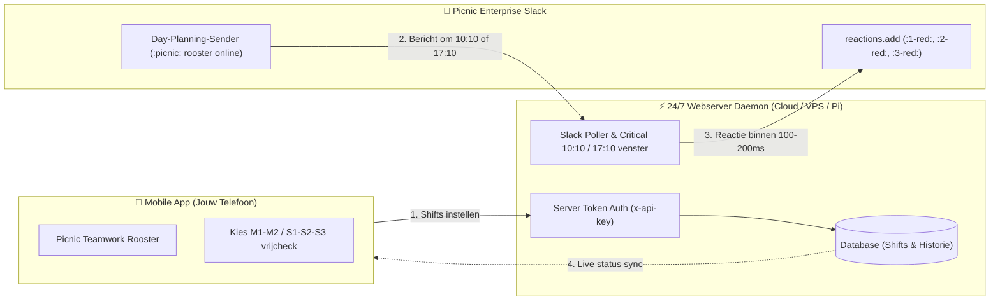

# ⚡ AutoChecker - Picnic Vrijcheck App & 24/7 Cloud Daemon

[](https://github.com/jayverrijt/AutoChecker/actions/workflows/android-release.yml)
[](https://github.com/jayverrijt/AutoChecker/actions/workflows/server-ci-cd.yml)
[](https://nodejs.org)
[](https://capacitorjs.com)
[](LICENSE)

> ⚠️ **Migratie-notitie**: De eerdere browser-extensie (`manifest.json` / `content.js`) is officieel **deprecated** en vervangen door deze moderne, standalone full-stack oplossing: een native Android-applicatie gekoppeld aan een 24/7 cloud server daemon.

---

## 🎯 Waarom AutoChecker?

Op mobiele apparaten (Android & iOS) schakelen besturingssystemen achtergrondprocessen na enkele minuten uit via **Doze-modus en batterijbesparing**. Hierdoor kan een telefoon simpelweg niet betrouwbaar 24/7 luisteren naar Slack wanneer het scherm uit staat.

**AutoChecker lost dit op met een tweedelig ecosysteem:**



1. **📱 Mobiele App (Android APK & PWA)**:
   - 1-op-1 look & feel van de officiële **Picnic Teamwork** app.
   - Weekoverzicht met 5 individuele blokken per dag (**M1, M2, S1, S2, S3**).
   - **Slide-to-Vrijcheck** bevestigingsslider en soepele pull-down modal.
   - Aangepast Superhero Avocado app-icoon (zonnebril, bliksemschicht & groen vinkje).
   - Dient als overzichtelijk dashboard: **je telefoon hoeft na het instellen niet aan te blijven!**

2. **⚡ 24/7 Webserver & Daemon**:
   - Draait continu op een VPS, thuisserver, Raspberry Pi of Docker container.
   - Beveiligd met een eigen **Server Authenticatie Token** (`SERVER_API_KEY`).
   - Schakelt tijdens kritieke vensters (**10:09:40–10:12:00** en **17:09:40–17:12:00**) over naar een ultra-responsieve pollingcyclus.
   - Reageert automatisch binnen **~100–180ms** met de juiste emoji op berichten van `Day-Planning-Sender`.

---

## 🕒 Shift & Emoji Matching Logica

| Shift Periode | Shift Blokken | Doeltijd Planning | Emoji Reactie |
|---|---|---|---|
| **OCHTEND** | **M1** (06:30 - 15:00) | Online om ~17:10:xx (vorige dag) | `:1-red:` |
| **OCHTEND** | **M2** (07:00 - 15:30) | Online om ~17:10:xx (vorige dag) | `:2-red:` |
| **MIDDAG** | **S1** (13:00 - 21:30) | Online om ~10:10:xx (dezelfde dag) | `:1-red:` |
| **MIDDAG** | **S2** (14:00 - 22:30) | Online om ~10:10:xx (dezelfde dag) | `:2-red:` |
| **MIDDAG** | **S3** (16:30 - 23:00) | Online om ~10:10:xx (dezelfde dag) | `:3-red:` |

---

## 🚀 Aan de slag

### 1. Webserver Installatie (24/7 Daemon)

Kopieer het configuratiebestand en vul je gewenste geheime server-token in:

```bash
cd server
cp .env.example .env
npm install
```

#### Draaien met PM2 (Aanbevolen voor 24/7 Uptime & Reboot Herstart)
```bash
npm install -g pm2
pm2 start ecosystem.config.cjs
pm2 save
pm2 startup
```

#### Of draaien met Docker
```bash
docker compose up -d --build
```

---

### 2. Mobiele App Bouwen (Android APK)

```bash
cd client
npm install
npm run build
npx cap sync android

# Android APK bouwen (vereist Java 21 & Android SDK):
cd android
./gradlew assembleDebug
```
Het gegenereerde bestand bevindt zich in:
`client/android/app/build/outputs/apk/debug/app-debug.apk`

---

## 🧪 Geautomatiseerde Testsuite & Emulator

In de repository is een ingebouwde **DayPlannerSender Emulator** aanwezig die de exacte Picnic Slack opmaak en netwerk-jitter simuleert:

```bash
cd server
npm test
```

**Testrapport:**
```text
✔ 1. Security: REST API rejects requests without Server Auth Token (401)
✔ 2. Security: REST API accepts requests with valid x-api-key header (200)
✔ 3. Security: Auth verification endpoint validates keys correctly
✔ 4. DayPlannerSender Emulation: Morning Shift (M1) Trigger -> :1-red: (136ms)
✔ 5. DayPlannerSender Emulation: Afternoon Shift (S3) Trigger -> :3-red: (124ms)
✔ 6. DayPlannerSender Emulation: Vrijcheck Disabled on Shift (Safely Ignored)
✔ 7. DayPlannerSender Emulation: Period Mismatch (Afternoon shift ignores morning message)
✔ 8. Multi-run Latency Stress Test (5 consecutive emulations with random jitter)
   ⚡ Gemiddelde reactielatency: ~107ms!
```

---

## 🔄 CI/CD Pipelines (GitHub Actions)

De repository bevat twee geautomatiseerde workflows:

### 1. Android APK Release (`android-release.yml`)
- Bouwt automatisch bij elke push naar `main` een verse debug APK.
- Uploadt de APK als **GitHub Actions Artifact** (`AutoChecker-Android-Debug-APK`).
- Maakt bij git tags (`v1.0.0`) automatisch een **GitHub Release** aan met de APK als download.

### 2. Server Deployment via SSH (`server-ci-cd.yml`)
- Voert automatisch de gehele testsuite uit.
- Verbindt via SSH met je target server (bijv. FleetHub / VPS) middels het ingestelde deployment secret:
  - `FLEETHUB_SSH_KEY` / `SSH_PRIVATE_KEY`
  - `FLEETHUB_HOST` / `SERVER_HOST`
  - `FLEETHUB_USER` / `SERVER_USER`
  - `FLEETHUB_DEPLOY_PATH` / `SERVER_PATH`

---

## 🔐 Picnic Enterprise Slack Sessie Ophalen

Omdat Picnic op **Slack Enterprise Grid** draait, gebruikt de bot jouw eigen sessietoken om reacties onder jouw naam te plaatsen:

1. Open **[picnic.enterprise.slack.com](https://picnic.enterprise.slack.com)** in je browser en meld je aan.
2. Druk op <kbd>F12</kbd> (of <kbd>Cmd+Option+I</kbd> op macOS) en ga naar de **Network** tab.
3. Zoek naar een willekeurig verzoek naar `conversations.history` of `client.boot`.
4. Kopieer:
   - **Authorization Header**: Bearer token (`xoxc-...`)
   - **Cookie Header**: Waarde van cookie `d` (`xoxd-...`)
5. Vul deze eenmalig in via het **Instellingen** menu van de AutoChecker app.

---

## 📄 Licentie & Auteursrechten

Copyright © 2026 Jay Verrijt. Uitgebracht onder de [MIT Licentie](LICENSE).
